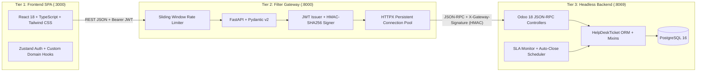
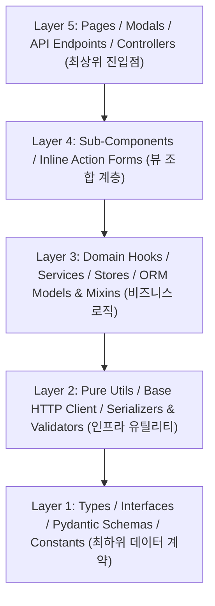
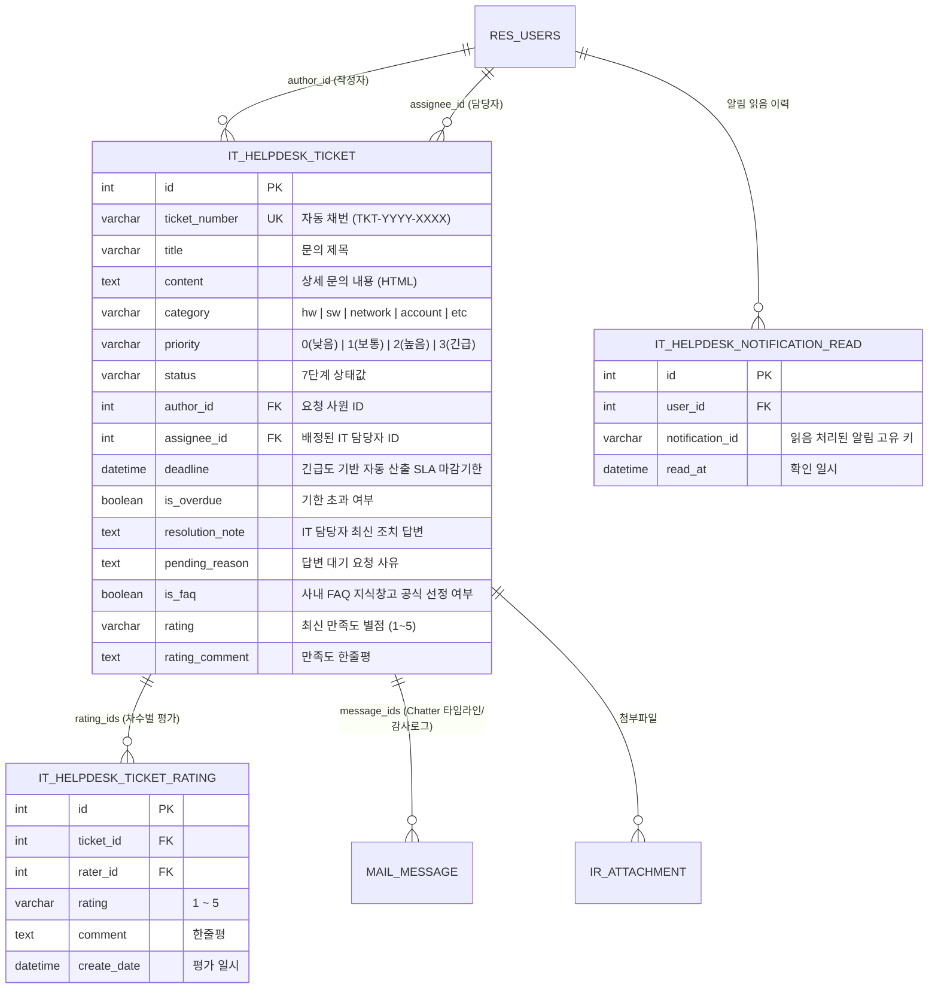
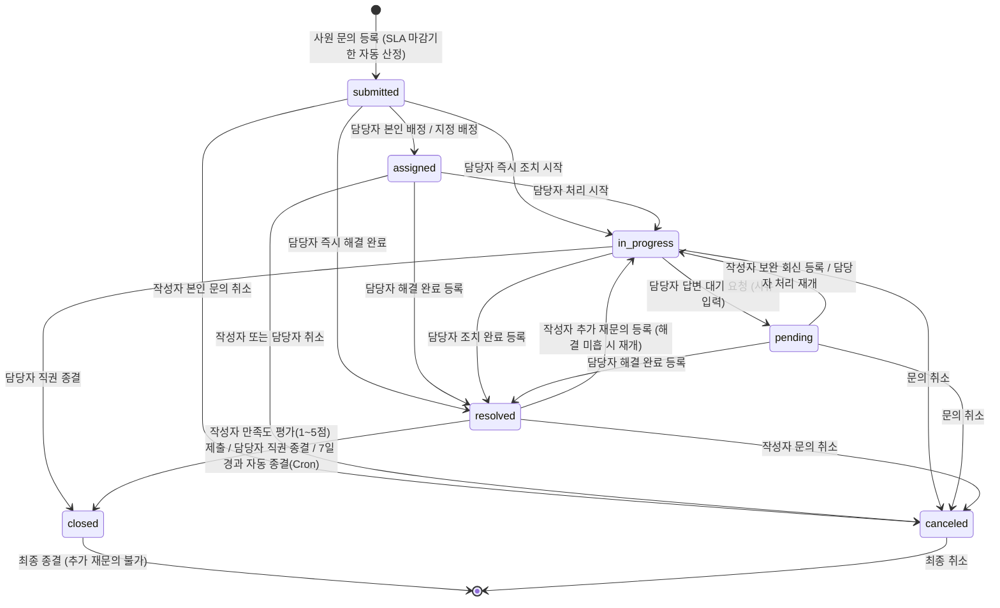

# 사내 IT 헬프데스크 (IT Company Board)

사내 임직원의 IT 인프라 문의(하드웨어, 소프트웨어, 네트워크, 계정/권한, 기타)를 접수부터 배정, 조치, 답변 대기, 만족도 평가, FAQ 지식창고 축적까지 일원화하여 관리하는 **3계층 분리 아키텍처(3-Tier Decoupled Architecture)** 기반 엔터프라이즈 IT 서비스 관리(ITSM) 시스템입니다.

---

## 1. 시스템 아키텍처 및 설계 근거

기존 모놀리식 ERP 웹 뷰의 결합도와 보안 노출면을 제거하기 위해 프론트엔드(SPA), 보안 게이트웨이(BFF/Filter), 비즈니스 백엔드(Headless ORM)를 물리적·논리적으로 분리한 3계층 아키텍처를 채택하였습니다.



### 계층별 기술 스택 및 역할

| 계층 | 구성 요소 | 기술 스택 | 핵심 역할 |
| :--- | :--- | :--- | :--- |
| **Tier 1** | Frontend SPA | Vite, React 18, TypeScript, Tailwind CSS, Zustand | 3계층 역할별(일반 사원/IT 담당자/IT 관리자) 대시보드 및 배지 시각화, 2단 복합 필터링, 실시간 SLA 배지, 다중 차수 Q&A 타임라인, 인라인 상태 제어 모달 |
| **Tier 2** | Filter Gateway | Python 3.11, FastAPI, Pydantic v2, HTTPX, PyJWT | Bearer JWT 인증 발급 및 역할 클레임(`is_officer`, `is_manager`), 요청 DTO 엄격 검증(`extra="forbid"`), 슬라이딩 윈도우 Rate Limiting(429), 백엔드간 HMAC-SHA256 서명 및 에러 표준화 |
| **Tier 3** | Headless Backend | Odoo 18.0 (`it_helpdesk`), PostgreSQL 16 | 티켓 채번(`TKT-YYYY-XXXX`), 3계층 권한 계층화(User -> Officer -> Manager), 7단계 워크플로우 상태 머신, SLA 마감일 자동 계산, Record Rule 기반 권한 격리, Chatter 감사 로깅, 배치 스케줄러 |

---

## 2. 5단계 단방향 비순환 의존성(DAG) 및 모듈화 설계

단일 파일 비대화와 모듈 간 순환참조(Circular Dependency)를 원천 차단하기 위해 전 계층의 모든 런타임 소스 코드(`.ts`, `.tsx`, `.py`)를 **최대 250줄(LOC) 이하**로 유지하며, 상위 계층에서 하위 계층으로만 참조가 흐르는 **5단계 단방향 DAG 규칙**을 준수합니다.



### 디렉터리 구조

```text
IT_Company_Board/
├── docker-compose.yml                        # 4개 컨테이너(frontend, filter, web, db) 통합 오케스트레이션
├── scripts/
│   └── seed_demo_data.py                     # 멱등성 보장 원클릭 초기 계정 및 시나리오 시드 스크립트
├── frontend/                                 # [Tier 1] React + TypeScript SPA
│   └── src/
│       ├── shared/
│       │   ├── types/common.ts               # [Layer 1] 공통 상태/카테고리/우선순위 타입 및 배지 매핑
│       │   └── utils/                        # [Layer 2] slaUtils.ts, fileUtils.ts, htmlUtils.ts
│       ├── api/                              # [Layer 2~3] client.ts, authApi.ts, ticketApi.ts, workflowApi.ts, notificationApi.ts
│       ├── stores/authStore.ts               # [Layer 3] Zustand 인증 세션 스토어
│       ├── features/
│       │   ├── dashboard/                    # 대시보드 도메인 (types, hooks, FilterBar, Pagination, OfficerStatsModal)
│       │   ├── notification/                 # 이메일 알림함 도메인 (hooks, EmailNotificationModal, FilterBar/List/Preview)
│       │   └── ticket/                       # 티켓 도메인 (types, 5개 서브 훅 + 파사드 훅, 6개 인라인 액션 폼, 상세/등록 모달)
│       └── pages/                            # [Layer 5] LoginPage.tsx, DashboardPage.tsx
├── filter/                                   # [Tier 2] FastAPI Security & Validation Gateway
│   ├── app/
│   │   ├── schemas/                          # [Layer 1] common.py, ticket.py, workflow.py, attachment.py, insight.py
│   │   ├── core/                             # [Layer 2] config.py, security.py (JWT & HMAC)
│   │   ├── client/odoo_client.py             # [Layer 2] 영속 커넥션 풀(Keep-Alive) 기반 JSON-RPC 클라이언트
│   │   ├── services/                         # [Layer 3] auth_service.py, ticket_service.py, workflow_service.py, attachment_service.py, insight_service.py
│   │   └── api/v1/endpoints/                 # [Layer 5] auth.py, tickets.py, ticket_workflow.py, ticket_attachments.py, ticket_insights.py
│   └── tests/test_gateway.py                 # 게이트웨이 단위 테스트 (Pytest 7종)
└── addons/
    └── it_helpdesk/                          # [Tier 3] Odoo 18 Headless Backend Addon
        ├── models/                           # [Layer 3] ticket.py, ticket_workflow_mixin.py, ticket_rating.py, notification_read.py
        ├── utils/                            # [Layer 2] request_context.py, security.py, validators.py, ticket_serializer.py, text_utils.py, mock_email.py, related_tickets.py
        ├── controllers/                      # [Layer 5] auth_api.py, ticket_query_api.py, ticket_workflow_api.py, attachment_api.py, insight_api.py
        ├── security/                         # 3계층 RBAC 그룹 및 Record Rules (ir.model.access.csv, it_helpdesk_security.xml)
        ├── data/                             # 자동 채번 시퀀스 및 SLA/자동종결 Cron 스케줄러
        └── tests/                            # 백엔드 단위, 권한 계층화 및 보안 감사 테스트 (TransactionCase 43종)
```

---

## 3. 데이터 모델(ERD) 및 워크플로우 상태 전이도

### 3.1 핵심 데이터 모델 (ERD)



### 3.2 7단계 티켓 워크플로우 상태 전이도



---

## 4. 주요 기능 명세

### 4.1 공통 및 요청 사원(Employee) 기능
* **카테고리별 동적 템플릿 접수 및 자유 서식 모드**:
  * 카테고리(SW, HW, 계정 등) 선택 시 필수 점검 항목(소프트웨어명, 재현 경로, 증상 등)이 동적 템플릿 필드로 활성화되며 타임라인에 `[항목명] 값` 형태로 표준 직렬화됩니다.
  * 자유로운 서식이 필요한 경우 원클릭 토글(`자유 입력으로 작성`)을 통해 단일 텍스트 서식으로 손쉽게 전환할 수 있습니다.
* **문의 접수 및 실시간 유사 사례 추천**: 제목/카테고리 입력 시 관련 FAQ 및 기존 해결 사례를 실시간 추천하여 중복 문의를 줄이고, 이미지/로그 파일(`ir.attachment`, 최대 5MB) 첨부를 지원합니다.
* **자동 SLA 기한 산정 및 잔여 시간 배지**: 긴급도에 따라 마감일(`긴급 4시간`, `높음 24시간`, `보통 48시간`, `낮음 72시간`)이 자동 계산되며, 카드 목록에 잔여/초과 시간 및 SLA 임박 배지가 실시간으로 표시됩니다.
* **접수대기(`submitted`) 상태 인라인 수정 및 문의 취소**: 담당자 배정 전 본인의 문의(제목, 긴급도, 카테고리, 내용)를 즉시 수정하거나, 미종결 문의를 사유와 함께 취소(`canceled`)할 수 있습니다.
* **답변 대기 회신 및 다중 차수 재문의**:
  * 담당자의 `답변 대기(pending)` 요청 시 상단 보라색 안내 배너를 통해 보완 정보를 즉시 회신(`in_progress` 전환, 차수 유지)합니다.
  * `해결완료(resolved)` 후에도 문제가 재발하면 **추가 재문의**를 등록하여 다음 차수 Q&A 타임라인을 이어갈 수 있습니다 (`종결(closed)` 시에는 재문의 차단).
* **만족도 평가 및 종결**: 해결된 티켓에 별점(1~5점)과 한줄평을 제출하면 티켓이 최종 `종결(closed)` 처리됩니다.
* **사내 FAQ 지식창고**: IT 담당자가 공식 선정한 해결 사례를 아코디언 뷰로 열람할 수 있습니다.

### 4.2 3계층 권한 구조 (Employee / Officer / Manager) 및 관리자 기능
* **3-Tier 권한 계층화 (User -> Officer -> Manager)**:
  * **일반 사원(Employee)**: 본인 문의만 등록/조회/수정/취소, 대기 회신, 만족도 평가, FAQ 열람 (초록색 배지).
  * **IT 담당자(Officer)**: 전체 티켓 조회, 배정 및 상태 제어, 조치 답변 등록 및 수정, FAQ 추천 토글, 담당자별 실적 통계 열람 (남색 배지). 단, 티켓 영구 삭제(`unlink`)는 차단.
  * **IT 관리자(Manager)**: IT 담당자의 모든 권한을 상속받으며, 티켓 완전 삭제(`unlink`), Odoo 관리자 전용 메뉴 열람, 타 담당자 배정 티켓 직권 강제 조치(직권 종결 등) 권한 보유 (보라색 배지).
* **전문 분야 기반 자동 배정 스위치**:
  * 카테고리별 전문 담당자(HW: 인프라, SW: 소프트웨어 등)를 판별하여 접수 즉시 자동으로 배정하는 자동 배정 엔진 지원 (`scripts/set_auto_assign.py on/off`).
* **단계별 워크플로우 제어 바**: 상세 모달 내에서 `[내게 배정]`, `[담당자 지정/인계(사유 필수)]`, `[내가 대신 맡기]`, `[처리 시작]`, `[답변 대기 요청]`, `[직권 종결]`, `[FAQ 지식창고 추천 토글]`을 원클릭으로 수행합니다.
* **조치 답변 등록 및 인라인 수정(Diff 로그)**: 해결 조치 등록 후 오기재 내용을 인라인으로 수정할 수 있으며, 수정 전/후 비교(Diff) 이력이 담당자/관리자 전용 감사 로그에 자동 기록됩니다.
* **담당자/관리자 전용 활동/감사 로그(`logs`)**: 상태 전이, 담당자 인계, 답변 수정 전후 내역 등 모든 Chatter 기록을 타임라인으로 열람합니다 (사원 화면에는 원천 비노출).
* **복합 필터링 및 '내 담당만' 토글**: 상단 6개 KPI 빠른 필터 카드(`전체`, `접수/배정`, `처리중`, `답변대기`, `해결완료`, `기한초과`), 검색창 300ms 디바운싱, `내 담당만` 슬라이드 토글, `기한 초과만` 슬라이드 토글, 5종 다중 정렬을 지원합니다.
* **담당자별 실적 통계 모달 및 MTTR(평균 해결 시간) 지표**: 담당자별 배정/처리중/해결/종결 건수, 완료율, 카테고리별 처리 비중 및 조직 전체 평균 MTTR(Mean Time to Resolve) 지표를 시각화합니다.
* **역할 기반 모의 이메일 알림함(DB 읽음 동기화 및 수신자 격리)**:
  * 수신자 역할별 맞춤 알림 발송: 요청 사원(배정/대기요청/조치완료), 담당자(본인 배정/재문의/평가), 신규 미배정 티켓(담당자/관리자 공통), 관리자 전용(SLA 에스컬레이션).
  * 미확인 배지 카운트 및 DB 영구 읽음 처리(`it.helpdesk.notification.read`)를 지원합니다.

---

## 5. 보안 및 예외 처리 설계

1. **이중 권한 격리 및 3계층 ACL (BOLA / IDOR 원천 차단)**:
   * 일반 사원은 본인이 작성한 티켓(`author_id = user.id`)과 공식 FAQ(`is_faq = True`)만 조회할 수 있습니다. 타인 티켓 ID로 상세 조회, 수정, 취소, 평가를 시도할 경우 FastAPI 게이트웨이와 Odoo Record Rule 양단에서 `HTTP 403 Forbidden`으로 즉시 차단합니다.
   * Odoo ACL(`ir.model.access.csv`) 수준에서 IT 담당자(Officer)의 영구 삭제(`perm_unlink`) 권한을 박탈(`0`)하고, IT 관리자(Manager)에게만 영구 삭제 권한(`1`)을 부여하여 운영 중 티켓 유실 사고를 원천 방어합니다.
2. **게이트웨이-백엔드 구간 HMAC-SHA256 서명 검증**:
   * FastAPI가 Odoo JSON-RPC를 호출할 때 `uid + timestamp + sha256(body)` 페이로드에 대해 `GATEWAY_SHARED_SECRET` 기반 HMAC 서명을 헤더로 주입하며, 타임스탬프 유효기간(300초) 초과 또는 서명 불일치 요청은 즉시 거부됩니다.
3. **Stored XSS 방어 및 HTML 정제**:
   * 사용자 입력 본문과 조치/회신 메시지는 `_safe_html_text()` 이스케이프 및 태그 스트리핑 파이프라인을 거쳐 저장·직렬화되므로 `<script>`, `<svg onload>` 등 악성 스크립트 실행이 원천 차단됩니다.
4. **낙관적 동시성 제어 (Optimistic Concurrency Control)**:
   * 두 명의 담당자가 동시에 동일 티켓을 조치하거나 수정할 때 `if_match_write_date` 타임스탬프를 비교하여, 선행 수정이 감지되면 데이터 덮어쓰기를 막고 `HTTP 409 Conflict`를 반환합니다.
5. **슬라이딩 윈도우 Rate Limiting**:
   * 인메모리 슬라이딩 윈도우 미들웨어를 통해 로그인 엔드포인트(분당 15회 초과 시 차단)와 일반 API(분당 180회)에 대한 브루트포스 및 과호출을 방어하고 `HTTP 429 Too Many Requests` 및 `Retry-After` 헤더를 반환합니다.

---

## 6. 빠른 시작 및 데모 데이터 시딩 가이드

### 6.1 사전 요구사항
* Docker 및 Docker Compose

### 6.2 환경변수 설정 및 컨테이너 기동
프로젝트 루트에 `.env` 파일을 확인(또는 생성)하고 컨테이너를 실행합니다.

```env
DB_NAME=postgres
DB_USER=odooU
DB_PASSWORD=odooPW
```

```bash
# 4개 컨테이너(frontend, filter, web, db) 빌드 및 백그라운드 기동
docker compose up -d --build
```

### 6.3 원클릭 초기 계정 및 데모 데이터 시딩
컨테이너 기동 후 아래 명령어를 실행하면 테스트 계정 5종과 상태별/긴급도별/FAQ/기한초과 데모 티켓 8종이 멱등성(Idempotent) 있게 자동 생성됩니다.

```bash
python scripts/seed_demo_data.py
```

### 6.4 접속 주소 및 테스트 계정

* **프론트엔드 웹 포털 (React SPA)**: http://localhost:3000
* **필터 게이트웨이 Swagger UI (FastAPI)**: http://localhost:8000/docs
* **Odoo 백오피스 (Headless Admin)**: http://localhost:8069

| 역할 구분 | 로그인 이메일 (ID) | 비밀번호 | 권한 및 특징 | UI 배지 |
| :--- | :--- | :--- | :--- | :--- |
| **IT 관리자** | `admin@helpdesk.com` | `admin` | 전체 티켓 제어, 직권 재배정/조치, 티켓 영구 삭제(`unlink`), Odoo 관리자 전용 메뉴, 백오피스 관리 | `IT 관리자` (보라색) |
| **IT 담당자 1** | `officer@test.com` | `1234` | 전체 티켓 열람, 배정/조치/대기요청/종결, FAQ 선정, 실적 통계 열람 (삭제 불가) | `IT 담당자` (남색) |
| **IT 담당자 2** | `officer2@test.com` | `1234` | 담당자 협업/인계 테스트 및 담당자별 실적 비교용 계정 | `IT 담당자` (남색) |
| **일반 사원 1** | `user1@test.com` | `1234` | 본인 문의 등록/수정/취소, 대기 회신, 재문의, 만족도 평가, FAQ 열람 | `일반 사원` (초록색) |
| **일반 사원 2** | `user2@test.com` | `1234` | 사원 간 티켓 격리(BOLA 차단) 검증 및 타 사원 문의 시뮬레이션용 계정 | `일반 사원` (초록색) |

---

## 7. 자동화 테스트 실행 방법

본 프로젝트는 백엔드 단위 테스트, 게이트웨이 테스트, 다중 사용자 E2E 시나리오, 가상 브라우저 UI 자동화 테스트를 모두 갖추고 있습니다.

```bash
# 1. Odoo 18 백엔드 단위, 3계층 권한 계층화 및 보안 감사 테스트 (43종)
docker exec it_helpdesk_odoo odoo -d helpdesk_db --db_host=db -r odooU -w odooPW --http-port=8070 -u it_helpdesk --test-enable --test-tags=it_helpdesk --stop-after-init

# 2. FastAPI 게이트웨이 단위 테스트 (7종)
docker exec it_helpdesk_filter pytest -v

# 3. 프론트엔드 단위 테스트 (Vitest 17종) 및 프로덕션 빌드
docker exec it_helpdesk_frontend npm run test

# 4. 전체 기능 관통 E2E 시나리오 자동화 테스트 (4개 역할, 5대 시나리오 66개 체크 100% 검증)
python local-md/ai-refactor-arch/scripts/test_full_scenario_e2e.py
```
